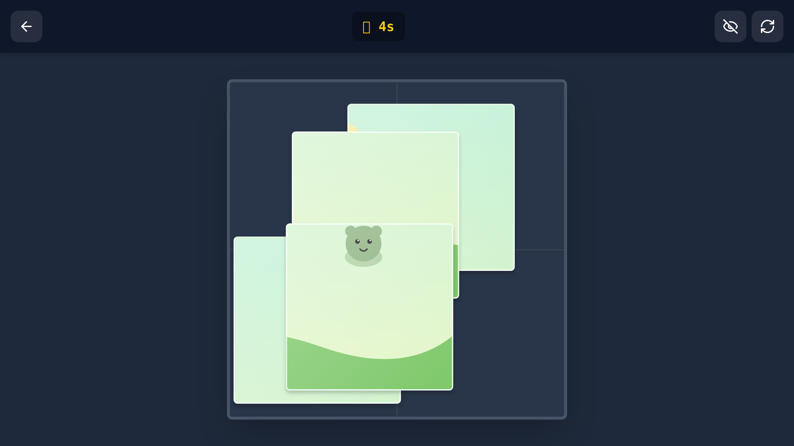

# Pusselmagi

Ett bildpussel för förskolan till åk 3. Barnet väljer tema och lägger pusselbitarna på plats med
fingrarna eller musen – från 4 bitar upp till 36.

**Spela:** https://pusselmagi.skolappar.com · En del av [Skolappar](https://www.skolappar.com) – pedagogiska appar av föräldrar · öppen källkod (MIT)



Började som ett Google AI Studio-projekt och körs nu fristående. Bilder och beröm skapades först
med AI; nu skapas de lokalt i webbläsaren.

## Vad du kan göra

- **Fyra teman**: Djur, Rymden, Natur och Sagor.
- **En ny bild varje gång**: en tecknad bild ritas fram i webbläsaren för valt tema.
- **Åtta svårighetsnivåer**, från Lätt (2×2) till Legend (6×6). Nästa nivå låses upp när du
  klarar den högsta du har.
- **Hoppa fram** genom att lösa ett gångertal – då låses en senare nivå upp direkt.
- Bitarna **snäpper fast** när de ligger rätt.
- **Stjärnor och poäng** efter tid; beröm när pusslet är klart.
- Ljudeffekter skapas i webbläsaren (Web Audio) och kan stängas av.

## Kom igång

```bash
npm install
npm run dev      # utvecklingsserver på port 3000
npm run build    # produktionsbygge till dist/
npm run preview  # förhandsgranska bygget
```

Docker-bygget använder Node 22.

## Docker

```bash
docker build -t pusselmagi .
docker run --rm -p 8080:8080 pusselmagi
```

Servern ligger bakom nginx med `deploy/nginx.conf`.

## Integritet

- Ingen inloggning, inga kakor, ingen analys, inga AI-tjänster.
- Inga anrop till externa servrar. Bilderna ritas som SVG i webbläsaren och typsnittet Fredoka
  ligger i `public/fonts/`.
- Poäng, stjärnor, antal pussel och upplåst nivå sparas i `localStorage` under
  `pusselMagiStats`.

## Struktur

```
App.tsx                    menyer, nivåer, spelplan, poäng, ljud
lib/artwork.ts             ritar pusselbilder och skapar beröm lokalt
services/praiseService.ts  kopplar beröm och teman
components/PuzzlePiece.tsx en pusselbit
components/Confetti.tsx    konfetti
deploy/nginx.conf          nginx-konfiguration
```

## Licens

MIT – se [LICENSE](LICENSE).
